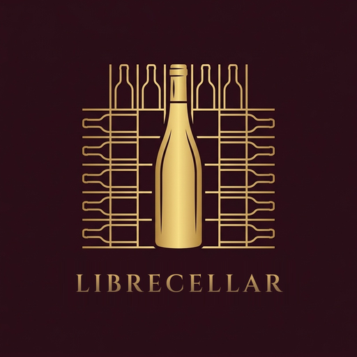

<p align="center">
  
</p>

<h1 align="center">LibreCellar</h1>

<p align="center">
  <b>Your wine cellar, on your phone. Your data, on your own server.</b>
</p>

---

LibreCellar is an open source Android app for managing a wine cellar. It works with the
**LibreCellar server**, which you run yourself on your own hardware: a home server, a NAS or a
Raspberry Pi. The server is also open source and will be released soon.

There is no LibreCellar cloud and no account with us. The app only talks to the server you set
up.

## Features

- **Inventory**: wines, vintages, bottles in stock, ratings, prices and suppliers
- **Barcode scanning** to find a wine or add a bottle quickly
- **Label reading**: take a photo of the label to fill in name, vintage, volume and alcohol
- **Cellar layout**: draw your racks and see which bottle is in which slot
- **Statistics** about your collection
- Works on **Android 8.0** and newer

## Privacy

LibreCellar is built so that you control your data:

- **No analytics, ads, crash reporting or trackers** are built into the app.
- **Your cellar data lives on your server.** The app's own network requests go only to the
  server address you enter.
- **Scans and label photos are processed on the phone.** Barcode scanning and label reading use
  Google's ML Kit with models bundled in the app. The images and the text found in them are not
  sent to Google.

To be clear about what we do not control:

- **ML Kit** may send Google technical metrics (device and app information, API performance and
  error codes) and may download model updates. See Google's
  [ML Kit terms](https://developers.google.com/ml-kit/terms).
- **Android backup**: if Google backup is on for your phone, Android may include the app's
  settings in it (server address, username, filters). Bottle photos are left out, and the
  login token can't be read on another device.
- **Google Play** handles installs and updates under Google's own terms.

The full details are in the [privacy policy](PRIVACY.md).

## Getting started

1. Set up the LibreCellar server on your network (release coming soon).
2. Install the app from Google Play, or build it from source.
3. Open **Settings**, enter your server's address and sign in.

### Building from source

```bash
./gradlew assembleDebug
```

Requires a recent Android Studio or JDK. Release signing is described in
`keystore.properties.example`.

## License

LibreCellar is free software, licensed under the
[GNU General Public License v3.0 or later](LICENSE), with an additional permission to link
with Google ML Kit (see [LICENSE-EXCEPTION](LICENSE-EXCEPTION)).
